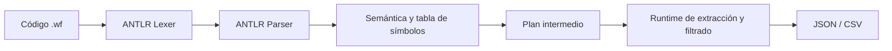

# Fetchuccini-DSL · Hito 2

Fetchuccini es un lenguaje declarativo para extraer datos de HTML estático mediante selectores CSS, filtrar registros y exportarlos a JSON o CSV. WebFetch desarrolla este proyecto para el curso Teoría de Compiladores de la UPC.

## Información del proyecto

| Dato | Valor |
| --- | --- |
| Institución | Universidad Peruana de Ciencias Aplicadas |
| Carrera | Ciencias de la Computación |
| Curso | Teoría de Compiladores, 1ACC0218 |
| Sección | 13962 |
| Profesor | Marco Antonio Sobrevilla Cabezudo |
| Ciclo | 2026-2 |
| Startup / producto | WebFetch / Fetchuccini |
| Entrega | Hito 2, segundo avance |
| Repositorio | [Fetchuccini-DSL](https://github.com/seskho/Fetchuccini-DSL) |

| Integrante | Contribución registrada en el Hito 1 |
| --- | --- |
| Diaz Orihuela, Jose Andres | Análisis semántico y driver |
| Garcia Hernandez, Alejandro Jhoshua | Construcciones del lenguaje y gramática |
| Landauro La Rosa, Ian Joshua | Construcciones del lenguaje y pruebas |
| Meza Dagnino, Francesco Andre | Analizador léxico y analizador sintáctico |

## Alcance del Hito 2

El front-end de ANTLR4 conserva las consultas anteriores y añade `EACH`, tipos opcionales y ocho diagnósticos semánticos. Una representación intermedia estructurada conecta ese análisis con un runtime que obtiene HTML, extrae campos, convierte números, evalúa `WHERE` y escribe archivos reales.

La validación es el modo predeterminado: no realiza HTTP ni exporta archivos. La ejecución debe solicitarse con `--execute`. El avance académico, las limitaciones y las pruebas realmente ejecutadas se registran en [ESTADO_HITO2.md](docs/ESTADO_HITO2.md).

## Instalación

Se requiere Python 3.10 o superior. Java es necesario únicamente para regenerar ANTLR; los archivos generados están incluidos. La verificación de esta entrega utiliza Python 3.12.14 y Java 25.

Desde la raíz del repositorio, en PowerShell:

```powershell
python -m venv .venv
.\.venv\Scripts\python.exe -m pip install -r requirements.txt
```

Los comandos siguientes usan `python` para facilitar su lectura. Se pueden ejecutar activando el entorno (`.\.venv\Scripts\Activate.ps1`) o sustituyendo `python` por `.\.venv\Scripts\python.exe`. Si Windows abre Microsoft Store al invocar `python`, debe utilizarse un intérprete instalado o la ruta del entorno; ese acceso directo no es un intérprete.

Las dependencias de ejecución son ANTLR4 Python Runtime 4.13.2, Requests, Beautiful Soup, Soup Sieve y urllib3. Pytest ejecuta las pruebas. Las versiones exactas están fijadas en [requirements.txt](requirements.txt).

## Sintaxis

```text
FETCH "https://books.toscrape.com/"
EACH "article.product_pod"
EXTRACT {
    titulo: attr("title") FROM "h3 a" AS STRING,
    precio: regex("[0-9.]+") FROM "p.price_color" AS NUMBER,
    disponibilidad: text FROM ".availability" AS STRING
}
WHERE precio < 25.00
EXPORT AS CSV TO "libros.csv";
```

| Construcción | Regla |
| --- | --- |
| `FETCH STRING` | Obligatoria, una URL HTTP o HTTPS con hostname válido. |
| `EACH STRING` | Opcional, después de FETCH; cada coincidencia CSS representa un registro. |
| `EXTRACT { alias: extractor FROM STRING [AS tipo], ... }` | Obligatoria, al menos un campo y alias únicos. |
| `WHERE expresión` | Opcional; comparaciones combinadas con AND y OR. |
| `EXPORT AS JSON TO STRING;` / `EXPORT AS CSV TO STRING;` | Obligatoria, ruta relativa y extensión coherente. |

Las palabras clave se escriben en mayúsculas, y los mecanismos `text`, `attr` y `regex` en minúsculas. Los comentarios comienzan con `--`. Las cadenas usan comillas dobles. Un patrón regex que necesite `\d` se escribe `"\\d+"` en el DSL: la primera barra protege la segunda dentro del literal.

Sin `EACH`, el documento completo constituye un único contexto. Con `EACH`, los selectores de los campos buscan dentro de cada elemento seleccionado. Si `EACH` no encuentra elementos, se exporta una colección vacía.

| Extractor | Valor del primer elemento coincidente |
| --- | --- |
| `text` | Texto con espacios normalizados. |
| `attr("nombre")` | Atributo solicitado. |
| `regex("patrón")` | Primera coincidencia completa sobre el texto original, conservando espacios y saltos. |

Un selector válido sin coincidencias, un atributo ausente o una regex sin coincidencias producen `None`. Un selector CSS o patrón regex inválido produce un error semántico antes de cualquier HTTP.

## Tipos y filtros

`AS STRING` conserva texto; `AS NUMBER` convierte el valor extraído a `float` finito. Sin anotación se asigna el tipo interno `AUTO`, compatible con el Hito 1. Un valor ausente conserva `None` incluso si su campo es NUMBER.

Los campos AUTO conservan el texto original en la exportación. En una comparación numérica, el runtime puede convertir temporalmente ese texto a número. Una conversión imposible se reporta como error de ejecución con el campo y el índice del registro.

`<`, `<=`, `>` y `>=` comparan números o valores convertibles. Un campo explícitamente STRING no participa en ordenamientos numéricos. `==` y `!=` comparan cadenas o números compatibles; una incompatibilidad conocida entre tipos explícitos se rechaza en semántica. Cuando la incompatibilidad depende del HTML, se detecta durante la ejecución.

**Toda comparación con `None` es falsa, también `!=`.** JSON lo representa como `null`; CSV, como celda vacía. No existe un literal `NULL` en esta versión.

`AND` tiene mayor precedencia que `OR`, y ambos usan cortocircuito. Por ejemplo:

```text
WHERE categoria == "Libros" OR precio >= 10 AND precio <= 50
```

equivale a `categoria == "Libros" OR (precio >= 10 AND precio <= 50)`. Los paréntesis permiten cambiar la agrupación y pueden anidarse. Por ejemplo, `WHERE (categoria == "Libros" OR categoria == "Revistas") AND precio < 25` aplica el límite de precio a ambas categorías.

## Ejecución

```powershell
# Consulta del Hito 1: solo validación
python src/driver.py tests/valid/01_consulta_basica.wf

# Tokens; --verbose conserva esta función y añade detalles
python src/driver.py tests/valid/01_consulta_basica.wf --tokens
python src/driver.py tests/valid/01_consulta_basica.wf --verbose

# Consulta con EACH: validación explícita
python src/driver.py examples/books_demo.wf --validate-only

# Error semántico nuevo; salida distinta de cero
python src/driver.py tests/invalid/S05_regex_invalida.wf

# Extracción local reproducible, sin conexión HTTP
python src/driver.py examples/catalogo_local.wf --execute --html tests/fixtures/catalogo.html

# Demostración real: CSV y JSON en outputs/
python src/driver.py examples/books_demo.wf --execute
python src/driver.py examples/books_json.wf --execute

# Los mismos formatos usando HTML local
python src/driver.py examples/books_demo.wf --execute --html tests/fixtures/catalogo.html
python src/driver.py examples/books_json.wf --execute --html tests/fixtures/catalogo.html
```

`--execute` y `--validate-only` son mutuamente excluyentes. `--html` exige `--execute` y sustituye la obtención HTTP por un archivo local UTF-8; no cambia la validación de la consulta. El programa informa registros encontrados, conservados tras el filtro, descartados y exportados, además de la ruta final. `run_compiler(file_path, verbose=False)` sigue devolviendo `(éxito, fase_fallida)`; la fase `runtime` distingue fallos de ejecución de los errores `io`, `lexical`, `syntax` y `semantic`.

Los nombres de salida se resuelven bajo `outputs/` de la raíz del proyecto, incluso al invocar el driver desde otro directorio. Se admiten subdirectorios relativos; se rechazan rutas absolutas, `..` y escapes del directorio permitido. La validación de nombre y extensión es semántica; un fallo de permisos o disco es de ejecución. JSON conserva números, Unicode y `null`; CSV mantiene el orden de declaración de los alias y crea encabezados incluso sin registros.

## Red y límites de seguridad

El cliente real se restringe por defecto a los orígenes `http://books.toscrape.com:80` y `https://books.toscrape.com:443`. Una URL HTTP válida de otro origen puede compilar, pero el cliente la rechaza al ejecutar. La API permite configurar explícitamente otros orígenes; la CLI no amplía esta lista.

Requests usa un adaptador con urllib3 que conecta a una dirección pública aprobada y comprueba el peer del socket. Cada redirección vuelve a validar el origen y el destino. Se desactivan proxies del entorno, se mantiene la verificación TLS y se aplican límites de tamaño, tiempo y redirecciones. Los detalles y límites están en [ARQUITECTURA_HITO2.md](docs/ARQUITECTURA_HITO2.md). Las pruebas principales usan HTML local y clientes simulados.

## Arquitectura y archivos



```text
grammar/               Lexer y parser ANTLR4
scripts/               Regeneración reproducible
src/generated/         Artefactos ANTLR4; no editar a mano
src/semantic/          Visitor, Symbol y SymbolTable
src/ir/                Dataclasses y construcción del plan
src/runtime/           HTTP, HTML, extracción, tipos, filtros y exportación
src/compiler.py        Front-end reutilizable
src/driver.py          CLI y compatibilidad run_compiler
src/literals.py        Decodificación de cadenas
src/output_paths.py    Validación y confinamiento de salidas
examples/              Consultas locales y Books to Scrape
tests/fixtures/        HTML ficticio para pruebas sin red
tests/valid/           Cinco consultas originales del Hito 1
tests/invalid/         Casos originales y S01-S08
tests/test_*.py        Pruebas automatizadas del Hito 2
docs/                  Documentación técnica y evidencia
outputs/               Resultados de ejecución; ignorados por Git
```

El runtime consume dataclasses independientes de ANTLR. Los filtros son nodos `Comparison`, `AndExpression`, `OrExpression` e identificadores/literales; nunca se ejecutan como código Python. La IR no supone una sustitución académica aprobada de LLVM: esa decisión corresponde al docente para el Hito 3.

## Ocho errores semánticos

| Código | Regla |
| --- | --- |
| S01 | Alias repetido en EXTRACT. |
| S02 | Identificador no declarado usado en WHERE. |
| S03 | URL con esquema o hostname no admitido. |
| S04 | Selector CSS inválido en EACH o EXTRACT. |
| S05 | Expresión regular inválida. |
| S06 | Nombre de atributo vacío tras eliminar espacios externos. |
| S07 | Formato/extensión incompatibles o ruta de salida insegura. |
| S08 | Comparación con tipos conocidos incompatibles. |

Los diagnósticos incluyen código, fase, línea y columna. Se acumulan errores independientes de manera segura. Las reglas, ejemplos y pruebas asociadas están en [SEMANTICA_HITO2.md](docs/SEMANTICA_HITO2.md).

## Regeneración de ANTLR4

```powershell
python scripts/generate_antlr.py
python scripts/generate_antlr.py --check
# Usar un JAR oficial local (cambiar la ruta por su ubicación)
python scripts/generate_antlr.py --check --jar C:/herramientas/antlr-4.13.2-complete.jar
```

El script usa exclusivamente ANTLR 4.13.2, valida el hash del JAR y lo almacena en `.antlr/`. La primera descarga requiere internet; puede utilizarse un JAR oficial local según la ayuda del script. `--check` regenera en un directorio temporal y compara los tres módulos Python byte por byte. No se modifican manualmente los archivos de `src/generated/`.

## Pruebas

```powershell
# Las nueve pruebas originales, sin cambios
python tests/run_tests.py

# Suite completa reproducible; no realiza peticiones a internet
python -m pytest -q

# Integración externa, solo cuando se solicita explícitamente
python -m pytest -q -m integration --run-live
```

La integración externa está deshabilitada en la ejecución normal. Sus cantidades dependen de la respuesta observada; no son constantes utilizadas para aprobar la suite local. [PLAN_VALIDACION_HITO2.md](docs/PLAN_VALIDACION_HITO2.md) explica niveles, entradas y criterios de aceptación. [ESTADO_HITO2.md](docs/ESTADO_HITO2.md) registra los resultados de esta entrega.

## Documentación y trabajo posterior

- [Arquitectura](docs/ARQUITECTURA_HITO2.md): contratos, responsabilidades y decisiones.
- [Gramática](docs/GRAMATICA_HITO2.md): cambios léxicos, reglas, precedencia y compatibilidad.
- [Semántica](docs/SEMANTICA_HITO2.md): S01-S08, tipos y política de ausencias.
- [Plan de validación](docs/PLAN_VALIDACION_HITO2.md): pruebas y criterios verificables.
- [Estado](docs/ESTADO_HITO2.md): evidencia ejecutada, pendientes y límites.
- [Entrega e informe](docs/ENTREGA_HITO2.md): inventario de archivos, comandos de demostración y cambios sugeridos al informe histórico.

Solo se procesa HTML estático de una página por consulta. Quedan fuera del Hito 2 `LIMIT`, `ORDER BY`, `JOIN`, `GROUP BY`, agregaciones, subconsultas, múltiples FETCH, EACH anidados, XPath, paginación automática, autenticación, JavaScript, funciones de usuario, aritmética general y LLVM. Para el Hito 3 corresponde acordar con el docente la ruta de generación de código, ampliar la evidencia de validación y preparar el informe, la presentación y el video, sin atribuir a esta entrega capacidades pendientes.
