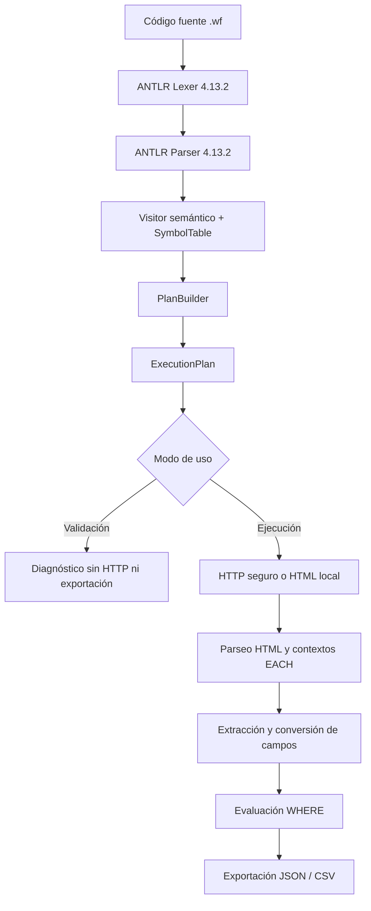

# Arquitectura de Fetchuccini para el Hito 2

## Objetivo y separación de responsabilidades

La arquitectura amplía el front-end del Hito 1 con una representación intermedia (IR) y un runtime. Una consulta solo puede ejecutarse después de superar todas las fases de compilación. El modo predeterminado termina al construir el plan; el usuario debe solicitar explícitamente la ejecución.



Los errores léxicos, sintácticos o semánticos detienen el pipeline antes del runtime. No se construye un plan ejecutable a partir de un árbol con errores. Los fallos del runtime se reportan por separado.

## Componentes

| Componente | Responsabilidad | Dependencias principales |
| --- | --- | --- |
| `grammar/` | Definir el vocabulario y la estructura del lenguaje. | ANTLR4 para regeneración. |
| `src/generated/` | Reconocer tokens y construir el parse tree. | Runtime ANTLR4 4.13.2. |
| `src/semantic/semantic_checker.py` | Verificar S01-S08 y registrar campos. | Visitor generado, `re`, Soup Sieve, validación de rutas. |
| `src/ir/models.py` | Definir datos y expresiones de la IR. | Dataclasses y tipos de Python. |
| `src/ir/plan_builder.py` | Traducir el parse tree válido a la IR. | Contextos ANTLR y modelos. |
| `src/compiler.py` | Coordinar análisis y construcción del plan. | Front-end; no realiza scraping. |
| `src/runtime/http_client.py` | Obtener HTML con controles de red y límites. | Requests y urllib3. |
| `src/runtime/html_parser.py` | Convertir HTML estático en un documento consultable. | Beautiful Soup y `html.parser`. |
| `src/runtime/extractor.py` | Crear contextos y extraer campos del HTML. | Beautiful Soup, Soup Sieve, `re`. |
| `src/runtime/type_conversion.py` | Convertir valores a NUMBER finito y conservar las ausencias. | `math` y errores del runtime. |
| `src/runtime/filter_engine.py` | Evaluar nodos WHERE sobre un registro. | IR y conversión numérica. |
| `src/runtime/exporter.py` | Serializar y escribir JSON o CSV. | `json`, `csv`, rutas confinadas. |
| `src/runtime/execution_engine.py` | Coordinar extracción, filtro y exportación. | IR y componentes del runtime. |
| `src/driver.py` | Exponer la CLI y la interfaz histórica. | Compilador y runtime. |
| `src/literals.py` | Decodificar escapes del literal STRING. | Biblioteca estándar. |
| `src/output_paths.py` | Validar nombres de salida y resolverlos bajo outputs. | `pathlib`. |

La conversión numérica pertenece al runtime y se comparte entre extracción y comparación. Una conversión de un valor NUMBER ocurre al extraerlo; una conversión de AUTO ocurre cuando el operador la requiere. Así, la exportación no altera el texto AUTO por haber participado en un filtro.

## Tabla de símbolos

Se reutilizan `Symbol` y `SymbolTable`, implementados con un diccionario de Python. Cada símbolo conserva nombre, mecanismo de extracción, tipo declarado y posición. La tabla sirve para detectar duplicados, resolver identificadores y comprobar compatibilidad de tipos. No existe una segunda tabla paralela en el runtime.

La consulta está formada por un único bloque EXTRACT y un WHERE posterior; no necesita ámbitos anidados. Los errores independientes se acumulan sin intentar resolver tipos de identificadores inexistentes.

## Representación intermedia

`ExecutionPlan` contiene los siguientes datos:

| Dato | Significado |
| --- | --- |
| `source_url` | URL ya validada semánticamente. |
| `each_selector` | Selector de registros o `None` para el documento completo. |
| `fields` | Secuencia de `FieldPlan` en orden de declaración. |
| `filter_expression` | Nodo lógico o `None` si no existe WHERE. |
| `export_format` | JSON o CSV. |
| `export_path` | Nombre relativo de salida. |

`FieldPlan` guarda `alias`, `extractor_type`, `selector`, `extractor_argument` y `declared_type`. La IR conserva información de posición cuando ayuda a los diagnósticos.

Los operandos son `Identifier`, `StringLiteral` y `NumberLiteral`. `Comparison` vincula dos operandos mediante un operador. `AndExpression` y `OrExpression` contienen nodos hijos, preservando la precedencia ya reconocida por el parser.

Para `a == "x" OR b >= 10 AND b <= 50`, la estructura conceptual es:

```text
OrExpression
├── Comparison(Identifier(a), ==, StringLiteral(x))
└── AndExpression
    ├── Comparison(Identifier(b), >=, NumberLiteral(10))
    └── Comparison(Identifier(b), <=, NumberLiteral(50))
```

La IR cumple también la función de árbol ejecutable; no se crea otro AST redundante. No contiene contextos ANTLR y no transforma expresiones en código ejecutable. La evaluación se implementa recorriendo los nodos.

Esta representación permite probar el runtime por separado y sustituir la obtención HTTP. Su uso en el Hito 2 no implica aprobación académica de generación sin LLVM para el Hito 3; esa alternativa debe consultarse con el docente.

## Contratos de ejecución

El cliente HTTP expone `fetch(url) -> str`. Una implementación simulada puede devolver un fixture o lanzar una excepción controlada. `execute_plan(plan, output_dir=None, http_client=None, html=None)` utiliza el plan y devuelve los registros y sus conteos.

| Conteo | Definición |
| --- | --- |
| `found_count` | Contextos seleccionados por EACH; sin EACH, uno. |
| `filtered_count` | Registros conservados después de WHERE. |
| `discarded_count` | Diferencia entre encontrados y conservados. |
| `exported_count` | Registros escritos. |

Los índices de registros en los errores comienzan en 1. El orden de los registros y de los campos se conserva.

## Política HTTP

La configuración predeterminada permite únicamente los orígenes de Books to Scrape en HTTP/80 y HTTPS/443. La autorización de un origen adicional se realiza explícitamente en la API, no desde la consulta DSL. Validar una URL no equivale a autorizar su ejecución en la red.

El adaptador de Requests usa pools de urllib3 con una conexión que resuelve el destino, rechaza direcciones no públicas y conecta directamente al sockaddr aprobado. La comprobación del peer verifica la dirección efectiva del socket; el hostname original se conserva para SNI y verificación del certificado HTTPS. Este diseño evita que una segunda resolución entre la validación y la conexión cambie el destino a una red privada.

Los proxies del entorno se desactivan. Las redirecciones se procesan manualmente; cada nuevo destino debe superar las mismas reglas de origen y conexión. Se rechazan localhost, loopback, redes privadas, link-local, site-local IPv6 y otras direcciones no públicas, incluidos destinos de metadatos cloud. Site-local se comprueba explícitamente mediante `is_site_local`, además de las demás propiedades de `ipaddress`; Python distingue esa categoría en su [documentación oficial](https://docs.python.org/3/library/ipaddress.html#ipaddress.IPv6Address.is_site_local). No se admiten credenciales en la URL.

Los límites de esta implementación son conexión de 5 s por dirección candidata, lectura de 10 s, plazo total cooperativo de 30 s comprobado antes/después de las peticiones y entre bloques, hasta tres redirecciones y 5 MiB de contenido descomprimido. La resolución DNS del sistema mediante `getaddrinfo` no tiene un plazo duro controlado por el runtime. Varias direcciones candidatas pueden consumir sus respectivos timeouts de conexión; el plazo cooperativo tampoco interrumpe una lectura bloqueada, que depende del timeout de lectura. Por eso 30 s no es una garantía estricta del tiempo total de pared. Se identifica el cliente mediante User-Agent.

El adaptador depende de puntos de extensión de Requests/urllib3. Las versiones se fijan y sus pruebas deben repetirse al actualizar esas bibliotecas. La obtención de red no es un navegador ni un sandbox general: su alcance es HTML estático de orígenes autorizados. La suite local verifica decisiones de conexión y redirección mediante simulación; una petición real aporta evidencia de integración, sin demostrar por sí sola todas las propiedades de seguridad.

## Política de escritura

El formato y el nombre de salida se validan antes de obtener HTML. El exportador vuelve a resolver la ruta para evitar escribir fuera del directorio configurado. La CLI siempre usa `outputs/` bajo la raíz del proyecto; `output_dir` existe en la API para aislar las pruebas.

Se permiten subdirectorios relativos. Se rechazan rutas absolutas de POSIX o Windows, componentes `..`, rutas UNC y otras formas de salida del directorio. Los enlaces existentes deben resolverse dentro de la raíz autorizada. Los fallos de permisos, creación o escritura pertenecen al runtime, no a S07.

El directorio de salida se considera un espacio local controlado por el usuario. La validación de rutas no pretende proteger frente a otro proceso que modifique simultáneamente el sistema de archivos durante la exportación.

## Decisiones y límites

1. ANTLR se mantiene como fuente de verdad para el reconocimiento sintáctico; sus artefactos se regeneran con versión fijada y comparación byte a byte.
2. Se conserva `run_compiler(...)` para las pruebas y usos anteriores. La CLI añade capacidades mediante opciones explícitas.
3. Soup Sieve valida selectores usando el mismo motor que ejecuta la extracción; la ausencia de coincidencias produce datos ausentes, no errores de compilación.
4. Los números se representan de forma consistente como `float` finito. No se introducen reglas monetarias, cambio de moneda ni formatos locales de separadores.
5. Ninguna consulta usa ejecución dinámica de Python. No se implementan páginas con JavaScript, autenticación, paginación, XPath ni las extensiones aplazadas del lenguaje.
6. `re` valida patrones y se limita el HTML descargado, pero no se implementa un timeout individual de regex. Los programas DSL se consideran entradas locales de confianza; no se ofrece un servicio público que ejecute consultas arbitrarias.

Las comprobaciones realmente realizadas y cualquier límite detectado se consignan en [ESTADO_HITO2.md](ESTADO_HITO2.md).
